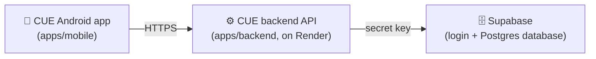

# Release: first APK for stakeholders (`release/apk-v1`)

This branch takes CUE from "runs on a developer's laptop" to "an Android app
25–40 people can install and use". This document explains what CUE is, how
the pieces fit together, everything we checked and changed on this branch, and
what is still left to do. No prior knowledge of the project is assumed.

---

## 1. What CUE is

CUE is a **behavioural finance app** for people in India: money tracking
combined with psychology.

1. A new user takes an **18-question assessment** about their relationship with
   money. Their answers place them into one of **10 money archetypes** (for
   example *The Comfort Spender* or *The Prepared One*).
2. They log their **spending**, money they have **lent or borrowed** (a
   *khata*), and their **subscriptions**.
3. CUE then sends them **nudges**: phone notifications whose wording is tuned
   to their archetype. A *Comfort Spender* might get "A soft pause. Your usual
   time for food orders is near", while an *Optimizer* gets "Run the numbers".

## 2. How the pieces fit together



| Piece | What it is | Where the code is |
|---|---|---|
| **Mobile app** | What users install. Built with React Native + Expo. | `apps/mobile` |
| **Backend API** | A Python (FastAPI) server. The app talks only to this. | `apps/backend` |
| **Supabase** | A hosted service that provides user login and the Postgres database. | Database changes are SQL files in `apps/backend/sql` |

**Important security rule:** the app never talks to Supabase directly and
holds no Supabase keys. Anything inside an APK can be extracted by anyone who
downloads it, so all secrets stay on the backend.

## 3. Words used in this document

| Word | Meaning |
|---|---|
| **APK** | The Android app file. People download and install it directly, without the Play Store. |
| **EAS** | Expo Application Services: Expo's cloud service that builds the APK for us. |
| **Render** | The hosting company where the backend server will run. |
| **Migration** | A SQL file that changes the database's structure (adds tables, columns and so on). |
| **Rate limit** | A cap on how often one address can call an endpoint, which stops password-guessing and spam. |
| **Environment variable** | A setting supplied to a program from outside its code, such as the backend's address. |

---

## 4. What we checked

Before changing anything, we ran every check the project has:

| Check | Result |
|---|---|
| Backend tests (`pytest`, 269 tests) | ✅ All pass |
| Mobile logic tests (`pnpm test`, 19 tests) | ✅ All pass |
| Mobile TypeScript type check (`tsc --noEmit`) | ✅ No errors |
| Expo's project health check (`expo-doctor`) | ❌ 2 of 21 failed → ✅ 21/21 after fixes |
| Backend running against the real Supabase | ✅ Starts and answers correctly, **but** the database was missing tables (see 5.1) |

## 5. What we found and fixed

### 5.1 The live database was missing two migrations ⚠️ (not a code change)

**Problem.** The code expected migrations `006_money_spec.sql` and
`007_notification_templates.sql` to be applied, but the Supabase database only
had migrations up to `005`. The tables for subscription cycles, balance
history and nudge wording did not exist.

**What users would have seen.** Subscriptions, the net-worth trend and
nudges would all have failed with a "service unavailable" error.

**Fix.** On **7 Nov 2026** we applied both migrations to the Supabase database
with `psql`, in order:

1. `006_money_spec.sql`: subscription billing days and monthly cycles, balance history.
2. `smoke_006.sql`: a self-check that exercises 006 and then rolls everything
   back, so it keeps no data. **It passed.**
3. `007_notification_templates.sql`: 110 starter nudge messages.

We then confirmed, through the backend's own connection, that every table and
database function responds.

> This change lives in the database, not in git, which is why it is recorded
> here. Anyone setting up a **new** Supabase project must run
> `apps/backend/sql/001` … `007` in order.

### 5.2 Code and configuration changes (one commit each)

| # | Commit | Problem | What would have gone wrong | Fix |
|---|---|---|---|---|
| 1 | `fix(mobile): align Expo SDK 57 package versions` | Two copies of the native module `expo-constants` were installed, and 18 packages were behind the versions Expo SDK 57 expects. | The native APK build could fail or behave unpredictably. | Ran `expo install --fix`. Health check now 21/21. |
| 2 | `build(mobile): link EAS project and add an APK build profile` | The app's backend address came from a local `.env` file, which is deliberately not in git, so EAS's cloud build never sees it. | **The APK would crash immediately on launch** ("EXPO_PUBLIC_API_URL must be set"). | The `preview` build profile in `apps/mobile/eas.json` now sets the address itself and produces an installable APK. Also removed a contradictory contacts permission (`WRITE_CONTACTS` was both requested and blocked; the app only reads contacts). |
| 3 | `feat(mobile): replace Expo template branding with CUE icon and splash` | The app was called "mobile", used Expo's sample icon, and showed the Expo logo on a blue screen at every launch. | Stakeholders would see someone else's branding. | Renamed the app to **CUE**, and added a stand-in icon and splash in CUE's purple-to-peach colours. |
| 4 | `build(backend): add a production Dockerfile` | The backend's Dockerfile was a single line and could not build a server. | The backend could not be deployed to Render. | A complete Dockerfile that runs as a non-root user, reads the port from the host, and sees each user's real IP address behind Render's proxy. |
| 5 | `fix(backend): size auth rate limits for group onboarding` | Signup was capped at 5 per hour per IP address. | People onboarding together on one Wi-Fi share one IP, so **everyone after the 5th signup would be refused**. | Signup 30/hour, login 30/minute. |
| 6 | `build: add Render blueprint for the backend` | No hosting configuration existed. | n/a | `render.yaml` describes the backend service for Render: free plan, Singapore region, health check. Secrets are entered in Render's dashboard and never committed. |
| 7 | `docs: add release README for this branch` | n/a | n/a | This document. |
| 8 | `build(mobile): point the APK at api.cuemoney.in and set package id` | The build still had a placeholder backend address and an auto-generated package id. | The APK could not reach any server. | Uses `https://api.cuemoney.in/api/v1` and the permanent id `in.cuemoney.app`. |

---

## 6. Launch checklist

### Done

- [x] **Branch pushed** to GitHub (`Finance-CUE/CUE-app`, branch `release/apk-v1`).
- [x] **Backend deployed on Render** from `render.yaml` (Blueprint "CUE-v1",
      service `cue-backend`, free plan, Singapore).
- [x] **Domain connected**: the backend lives at **`https://api.cuemoney.in`**.
      DNS for `cuemoney.in` is managed at **Hostinger**, where a `CNAME` record
      for `api` points to the Render service. Render provides the HTTPS certificate.
- [x] **Live end-to-end test** (8 Nov 2026). A script exercised signup, login,
      token refresh, the full assessment, spends, subscriptions and their monthly
      prompts, khata, net worth, the balance trend and the nudge plan against
      `api.cuemoney.in`. All 27 checks passed, and the test account and its data
      were deleted afterwards.
- [x] **App pointed at the live backend** and **package id set to `in.cuemoney.app`**
      (commit `build(mobile): point the APK at api.cuemoney.in and set package id`).
- [x] **APK build started on EAS** (`preview` profile). Expo generated the Android
      signing key and keeps it on Expo's servers. Every future build must be signed
      with the same key, so don't delete it from the Expo dashboard.

### Still to do

- [ ] **Keep the free server awake.** Render's free plan sleeps after 15 idle
      minutes and then takes about 50 seconds to wake. The app gives up after
      15 seconds, so a sleeping server means "Could not reach CUE". Fix: a free
      pinger (cron-job.org or UptimeRobot) that calls
      `https://api.cuemoney.in/health` every 10 minutes.
- [ ] **Raise Supabase's sign-in rate limits** (Supabase → Authentication → Rate Limits).
      Every user's login reaches Supabase from the backend's single server address,
      so Supabase's per-address limit covers all our users together.

### Making a new APK later

After changing the app, commit and push, then run:

```bash
cd apps/mobile
npx eas-cli build -p android --profile preview
```

EAS prints a link to the build page, which has the APK download and a QR code.
Backend changes need a manual deploy in Render (auto-deploy is off on purpose).

## 7. Known limitations of this first version

- **The icon is a stand-in** (a clock on CUE's gradient) until a designed logo exists.
  Replace the files in `apps/mobile/assets/images/`.
- **Nudge wording is placeholder copy.** Every message starts with `[PLACEHOLDER]`.
  It can be edited without a code change in Supabase → Table editor →
  `notification_templates`.
- **The APK is installed by hand ("sideloaded").** Android asks people to allow
  installs from their browser or file manager the first time. iPhone users cannot
  install it; iOS needs a separate build and an Apple developer account.
- **The Expo project is still named `mobile`** under the personal Expo account
  `caraxes22`. It works, but moving it to an organisation account is worth doing
  before more people work on it.
- **Email addresses are not verified at signup** (no email sender is configured yet).
- **Free hosting:** one small server, fine for 25–40 people. Rate-limit counters
  live in that server's memory, so they reset whenever it restarts.

## 8. Running it yourself

**Backend** (needs Python 3.12 and `apps/backend/.env`; copy `.env.example`):

```bash
cd apps/backend
python -m venv .venv && .venv/Scripts/pip install -r requirements.txt pytest   # Windows paths
.venv/Scripts/python -m pytest -q          # run the tests
.venv/Scripts/python -m uvicorn app.main:app --reload --host 0.0.0.0
```

**Mobile** (needs Node and pnpm; set `EXPO_PUBLIC_API_URL` in `apps/mobile/.env`):

```bash
pnpm install
cd apps/mobile
pnpm test               # logic tests
npx tsc --noEmit        # type check
npx expo-doctor         # project health check
pnpm start              # run in development
```
